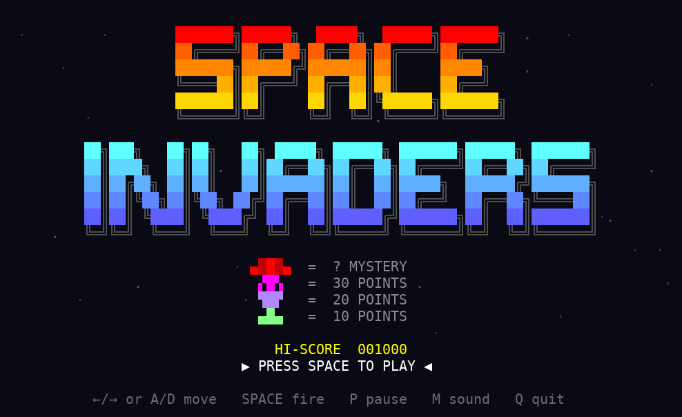

# Space Invaders in GnuCOBOL

A terminal Space Invaders written in a single GnuCOBOL source file:
UTF-8 block-character sprites, 256-colour ANSI graphics, animation and
synthesized sound effects.




A full-quality recording is in [docs/gameplay.mp4](docs/gameplay.mp4).
It is a scripted bot playing the real binary (see [Recording](#recording)).

## Requirements

- Linux (the raw keyboard handling uses the glibc `termios` layout)
- [GnuCOBOL](https://gnucobol.sourceforge.io/) 3.x (`dnf install gnucobol`,
  `apt install gnucobol`)
- A UTF-8 terminal with 256 colours, at least 80x24
- Python 3 to generate the sound effects
- Optional: `pw-play`, `paplay` or `aplay` to hear them

## Build and run

```
make          # builds ./invaders and generates sounds/
make run
```

Run it from the project directory, since the sounds are loaded from
`./sounds`. Without them, or without an audio player, the game is silent.

## How to play

| Key            | Action        |
| -------------- | ------------- |
| `←` `→` / `A` `D` | move       |
| `Space`        | fire          |
| `P`            | pause         |
| `M`            | sound on/off  |
| `Q`            | quit          |

- Invaders are worth 10, 20 or 30 points by row. The mystery ship crossing
  the top is worth 50-300.
- Shields wear down block by block (`█ ▓ ▒ ░`) under fire from both sides.
- You get 3 lives and one extra life at 1500 points.
- Each wave starts lower and faster, and the invaders speed up as you
  thin them out.
- The high score is saved to `invaders.hi`.

## How it works

`DISPLAY ... AT` in GnuCOBOL goes through curses one byte at a time, which
breaks multi-byte UTF-8 characters. So `invaders.cob` drives the terminal
itself:

- `tcgetattr`/`tcsetattr` put the tty in raw non-blocking mode and `read()`
  polls the keyboard once per frame.
- Each frame is drawn into a grid of cells (one UTF-8 character and one
  256-colour number each), converted to ANSI escape sequences in a single
  buffer and sent with one `write()`, so there is no flicker.
- Sounds are fire-and-forget: `system()` starts a player in the background.

## Recording

`tools/record.py` regenerates the screenshot and videos in `docs/`. It
runs the game on a pty with a bot that dodges bombs and shoots the lowest
invaders, replays the output into a cell grid, draws it with Pillow and
encodes it with ffmpeg. Needs Python with Pillow and ffmpeg.

```
make && python3 tools/record.py
```

## Files

| Path                   | What                                       |
| ---------------------- | ------------------------------------------ |
| `invaders.cob`         | the game                                   |
| `Makefile`             | `make`, `make run`, `make clean`           |
| `tools/gen_sounds.py`  | synthesizes the WAV effects into `sounds/` |
| `tools/record.py`      | records the bot playing for `docs/`        |
